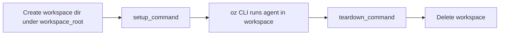

# Managed: Direct backend

> [[raw/docs/llms-docs-warp-dev/factories-self-hosting-managed-direct|Raw]] · llms-txt

## Summary

This is a vendor setup page. The docs state that the `oz-agent-worker` daemon can run with a **Direct backend**: tasks execute on the worker host itself, with no Docker or Kubernetes. The Automation Platform still orchestrates runs end to end (Slack, Linear, schedules, API, `oz agent run-cloud`); the worker only runs the agent in a per-task workspace. [[raw/docs/llms-docs-warp-dev/factories-self-hosting-managed-direct#Managed: Direct backend|cite]]

The docs recommend it when no container runtime exists, when tasks need host resources hard to expose to a container, or when you want managed orchestration without container overhead. They warn that it gives no per-task container isolation: tasks share the host OS and kernel. [[raw/docs/llms-docs-warp-dev/factories-self-hosting-managed-direct#When to use the Direct backend|cite]]

## Key claims

- Lifecycle: create workspace, run optional `setup_command`, run the `oz` CLI in it, run optional `teardown_command`, then clean up. [[raw/docs/llms-docs-warp-dev/factories-self-hosting-managed-direct#How it works|cite]]
- Start with `oz-agent-worker --api-key "$WARP_API_KEY" --worker-id "my-worker" --backend direct`, or a YAML config with `backend.direct.workspace_root`. Default root is `/var/lib/oz/workspaces`. [[raw/docs/llms-docs-warp-dev/factories-self-hosting-managed-direct#2\. Start the worker with the Direct backend|cite]]
- `--no-cleanup` keeps workspaces for debugging. Setting `target_dir` makes all tasks share one directory and disables isolation; use it only for one task at a time. [[raw/docs/llms-docs-warp-dev/factories-self-hosting-managed-direct#Workspace model|cite]]
- `setup_command` receives `OZ_WORKSPACE_ROOT`, `OZ_RUN_ID`, `OZ_ENVIRONMENT_FILE` (write `KEY=VALUE` lines to inject env vars) and `OZ_WORKER_BACKEND=direct`. `teardown_command` receives all but the env file. [[raw/docs/llms-docs-warp-dev/factories-self-hosting-managed-direct#Setup and teardown commands|cite]]
- Tasks start with a minimal environment (`HOME`, `TMPDIR`, `PATH`) so `WARP_API_KEY` does not leak; extra variables come from `environment` in config or `-e` flags. [[raw/docs/llms-docs-warp-dev/factories-self-hosting-managed-direct#Environment variables for Direct tasks|cite]]
- A separate docs page covers one Git worktree per task for large monorepos. [[raw/docs/llms-docs-warp-dev/factories-self-hosting-managed-direct#Workspace model|cite]]

## Notable quotes

> "The Direct backend does not provide per-task container isolation. Each task runs in an isolated workspace directory, but shares the host OS and kernel."
> — [[raw/docs/llms-docs-warp-dev/factories-self-hosting-managed-direct#When to use the Direct backend|When to use the Direct backend]]

## Connections

- **Entities**: [[wiki/entities/warp-factories]], [[wiki/entities/slack]], [[wiki/entities/linear]]
- **Concepts**: [[wiki/concepts/self-hosting]], [[wiki/concepts/agent-runner]], [[wiki/concepts/secrets-management]], [[wiki/concepts/git-worktree]]

> Synthesis: Direct is the lightest self-hosted runner tier, trading isolation for simplicity; the minimal-env default is the docs' main secrets safeguard.
