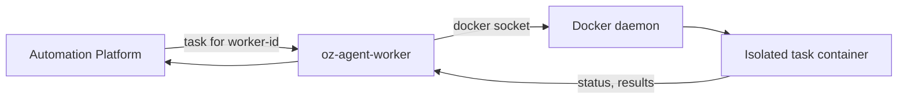

# Managed: Docker backend

> [[raw/docs/llms-docs-warp-dev/factories-self-hosting-managed-docker|Raw]] · llms-txt

## Summary

The docs state that the `oz-agent-worker` daemon, run with the Docker backend, is the default managed self-hosting path: each agent task runs in an isolated Docker container spawned by the worker, while the Automation Platform orchestrates triggers (Slack, Linear, schedules, API, `oz agent run-cloud`). [[raw/docs/llms-docs-warp-dev/factories-self-hosting-managed-docker#Managed: Docker backend|cite]] It is pitched as the simplest managed setup: per-task isolation without a Kubernetes cluster. [[raw/docs/llms-docs-warp-dev/factories-self-hosting-managed-docker#When to use the Docker backend|cite]]

The worker authenticates with `WARP_API_KEY`, connects out to the platform, waits for tasks routed to its `--worker-id`, runs each in a container and reports results back; it reconnects automatically. Several workers can share one `--worker-id` for redundancy and the platform spreads tasks across them. [[raw/docs/llms-docs-warp-dev/factories-self-hosting-managed-docker#Option 3: GitHub Releases binary|cite]] Three install routes exist: a Docker container (recommended, Linux), Homebrew, or a release binary (the route for macOS and Windows hosts). [[raw/docs/llms-docs-warp-dev/factories-self-hosting-managed-docker#Install and run the worker|cite]]

## Key claims

- Prerequisites: a `linux/amd64` or `linux/arm64` Docker daemon running Linux containers; Windows containers are unsupported. Task images must be glibc-based; musl images such as Alpine are unsupported. [[raw/docs/llms-docs-warp-dev/factories-self-hosting-managed-docker#Prerequisites|cite]]
- Config comes from CLI flags or a YAML file (`--config-file`); flags win. Documented settings include `worker_id`, `log_level`, `max_concurrent_tasks`, `idle_on_complete` and `backend.docker` volumes and environment. [[raw/docs/llms-docs-warp-dev/factories-self-hosting-managed-docker#Docker backend configuration|cite]]
- When the worker itself runs in Docker there are two `-e` levels: Docker's `-e` feeds the worker container, the worker's own `-e`/`--env` feeds spawned task containers. [[raw/docs/llms-docs-warp-dev/factories-self-hosting-managed-docker#Docker backend configuration|cite]]
- The worker finds the daemon via `DOCKER_HOST`, then the default socket, then `DOCKER_CONTEXT`, then `~/.docker/config.json`. The published image runs non-root, so a mounted rootful socket needs `--group-add` with the socket's group ID; a remote daemon can use TLS (`DOCKER_TLS_VERIFY`, `DOCKER_CERT_PATH`). [[raw/docs/llms-docs-warp-dev/factories-self-hosting-managed-docker#Docker connectivity|cite]]
- Private task-image registries use the worker account's Docker config; for a containerized worker the docs mount a dedicated read-only config at `/home/oz/.docker` owned by uid 10001. [[raw/docs/llms-docs-warp-dev/factories-self-hosting-managed-docker#Private Docker registries|cite]]
- Runs are routed to the worker with `--host "<your-worker-id>"`, identical across managed backends. [[raw/docs/llms-docs-warp-dev/factories-self-hosting-managed-docker#Routing runs to this worker|cite]]

## Notable quotes

> "Docker's `-e` passes env vars to the **worker container** (e.g., `WARP_API_KEY`). The worker's `-e` / `--env` flags pass env vars into the **task containers** the worker spawns."
> — [[raw/docs/llms-docs-warp-dev/factories-self-hosting-managed-docker#Docker backend configuration|Docker backend configuration]]

## Connections

- **Entities**: [[wiki/entities/warp-factories]], [[wiki/entities/docker]], [[wiki/entities/slack]], [[wiki/entities/linear]]
- **Concepts**: [[wiki/concepts/self-hosting]], [[wiki/concepts/agent-runner]], [[wiki/concepts/secrets-management]]

> Synthesis: Vendor how-to for the container-per-task flavor of the self-hosted worker; sibling pages cover the Kubernetes backend, the config reference and private registries, and this one is the baseline they differ from.
