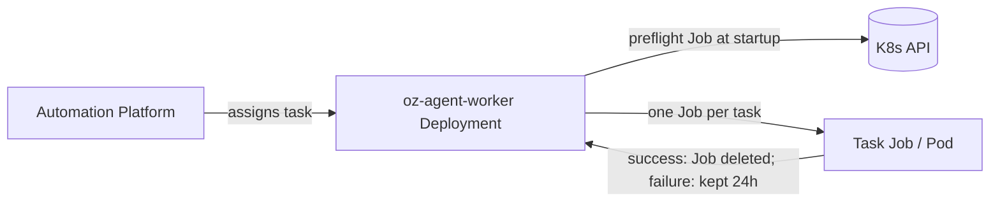

# Managed: Kubernetes backend

> [[raw/docs/llms-docs-warp-dev/factories-self-hosting-managed-kubernetes|Raw]] · llms-txt

## Summary

The docs state that the managed self-hosting Kubernetes backend splits duties: the Automation Platform orchestrates runs, and your cluster handles compute, scheduling and policy enforcement. You deploy the `oz-agent-worker` daemon with a namespace-scoped Helm chart. Each assigned agent task becomes a Kubernetes Job whose Pod comes from a configurable `pod_template`. [[raw/docs/llms-docs-warp-dev/factories-self-hosting-managed-kubernetes#Managed: Kubernetes backend|cite]]

The page is a deployment guide: prerequisites and RBAC, chart install, key Helm values, cluster selection, pod template, task sizing, preflight, secrets, disruption protection, capacity planning and metrics. It targets teams that already run Kubernetes and want Secrets, ServiceAccounts and admission policies to govern agent behavior. [[raw/docs/llms-docs-warp-dev/factories-self-hosting-managed-kubernetes#When to use the Kubernetes backend|cite]]

## Key claims

- Lifecycle: the worker connects to the API server, runs a preflight Job, creates a Job per task, watches it, deletes it on success; failed Jobs stay 24 hours by default. [[raw/docs/llms-docs-warp-dev/factories-self-hosting-managed-kubernetes#How it works|cite]]
- The chart deploys a Deployment, ServiceAccount, Role, RoleBinding, ConfigMap and an optional API-key Secret. It creates no CRDs or cluster-scoped RBAC, and runs non-root (`runAsUser: 10001`). [[raw/docs/llms-docs-warp-dev/factories-self-hosting-managed-kubernetes#What the chart deploys|cite]]
- Each release runs one worker replica; to scale out, install more releases with distinct worker IDs. `image.tag` must be pinned, not `latest`. [[raw/docs/llms-docs-warp-dev/factories-self-hosting-managed-kubernetes#3\. Install the chart|cite]]
- Task images must be glibc-based; Alpine/musl is unsupported. Without a Warp environment, the default image falls back to `ubuntu:22.04`. [[raw/docs/llms-docs-warp-dev/factories-self-hosting-managed-kubernetes#Prerequisites|cite]]
- Task sizing: the worker sets no CPU/memory defaults. Resources come from the `task` container in `pod_template` or from a runner's instance shape, which sets request equal to limit. [[raw/docs/llms-docs-warp-dev/factories-self-hosting-managed-kubernetes#Size task containers|cite]]
- Secrets reach tasks via `valueFrom.secretKeyRef` in `pod_template`, or `-e`/`--env` flags; external secret managers go through a CSI driver or operator. [[raw/docs/llms-docs-warp-dev/factories-self-hosting-managed-kubernetes#Environment variables for Kubernetes tasks|cite]]
- Evicting a task pod kills the run and its `emptyDir` workspace; a replacement cannot resume. The docs advise Karpenter `do-not-disrupt` annotations, and note PDBs only cover the Eviction API. [[raw/docs/llms-docs-warp-dev/factories-self-hosting-managed-kubernetes#Protect active task pods from disruption|cite]]
- `worker.maxConcurrentTasks` defaults to 0 (unlimited); tasks unschedulable past `unschedulableTimeout` (default 10m) fail. [[raw/docs/llms-docs-warp-dev/factories-self-hosting-managed-kubernetes#Plan capacity and scheduling|cite]]

## Notable quotes

> "The Automation Platform orchestrates runs; your cluster handles compute, scheduling, and policy enforcement."
> — [[raw/docs/llms-docs-warp-dev/factories-self-hosting-managed-kubernetes#Managed: Kubernetes backend|intro]]

> "Passing preflight doesn't validate task images, Secrets, setup commands, or network access."
> — [[raw/docs/llms-docs-warp-dev/factories-self-hosting-managed-kubernetes#Preflight check|Preflight check]]

## Connections

- **Entities**: [[wiki/entities/warp-factories]], [[wiki/entities/kubernetes]], [[wiki/entities/docker]]
- **Concepts**: [[wiki/concepts/self-hosting]], [[wiki/concepts/agent-runner]], [[wiki/concepts/secrets-management]], [[wiki/concepts/dev-environment]]

> Synthesis: One of several managed self-hosting backends in the Warp docs; vendor documentation, so it shows intended operations, not field-tested behavior.
