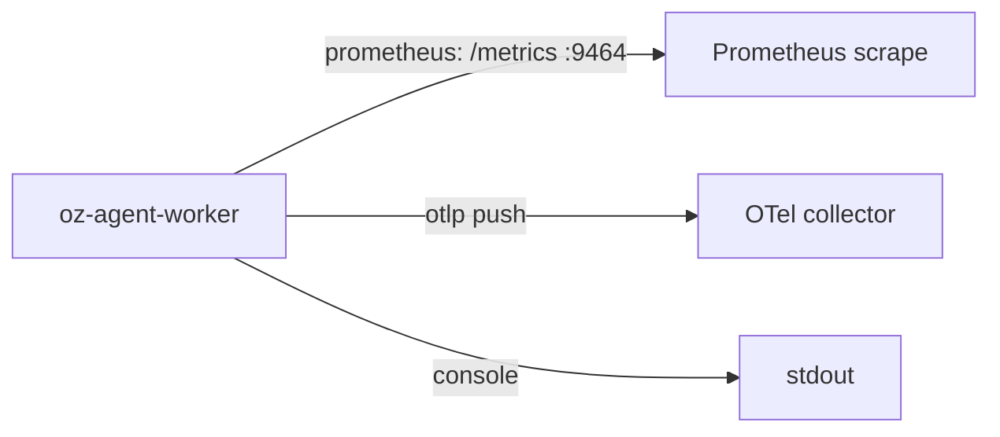

# Self-hosted worker monitoring

> [[raw/docs/llms-docs-warp-dev/factories-self-hosting-monitoring|Raw]] · llms-txt

## Summary

The docs state that the `oz-agent-worker` daemon, which runs agent tasks on self-hosted compute for the Automation Platform, exports OpenTelemetry metrics covering worker health, task throughput and capacity. The metrics can be used alongside the cloud agent dashboard to watch self-hosted and cloud runs. [[raw/docs/llms-docs-warp-dev/factories-self-hosting-monitoring#Self-hosted worker monitoring|cite]]

The worker picks its exporter at runtime from `OTEL_METRICS_EXPORTER` via the OpenTelemetry autoexport package: `prometheus` (in-process `/metrics` server), `otlp` (push, HTTP/protobuf by default), `console` (stdout, for debugging) or `none`. If unset, OTLP is used. All series carry resource attributes `service.name`, `service.version`, `worker.id` and `worker.backend`, so each worker process is a distinct series. [[raw/docs/llms-docs-warp-dev/factories-self-hosting-monitoring#How it works|cite]]

The page also covers the Helm chart (`metrics.enabled=true` adds a metrics port, env vars, a `Service`, and an optional `PodMonitor` for the Prometheus Operator), a ten-metric catalog with `oz_worker_` prefix, sample PromQL queries, and how to disable export.

## Key claims

- Prometheus mode is enabled with `OTEL_METRICS_EXPORTER=prometheus`, host `0.0.0.0` and port `9464`; bind to `0.0.0.0` (not localhost) in Docker or Kubernetes so scrapers can reach it. [[raw/docs/llms-docs-warp-dev/factories-self-hosting-monitoring#Enable Prometheus scrape|cite]]
- The Helm chart defaults `metrics.enabled` to `false`, `metrics.exporter` to `prometheus`, and `metrics.podMonitor.create` to `false` (to avoid requiring `monitoring.coreos.com` CRDs); PodMonitor defaults are 30s interval, 10s timeout. [[raw/docs/llms-docs-warp-dev/factories-self-hosting-monitoring#Helm values|cite]]
- Metrics include `oz_worker_connected`, `oz_worker_tasks_active`, `oz_worker_tasks_max_concurrent` (0 = unlimited), claimed/rejected/completed counters, `oz_worker_task_duration_seconds`, `oz_worker_task_failures_total{phase,reason}` (reasons like `image_pull`, `unschedulable`, `container_oom`, `evicted`) and websocket reconnect counts. [[raw/docs/llms-docs-warp-dev/factories-self-hosting-monitoring#Metric catalog|cite]]
- Completed-task results are labeled `succeeded`, `failed`, `cancelled` or `dispatched`. [[raw/docs/llms-docs-warp-dev/factories-self-hosting-monitoring#Metric catalog|cite]]
- Fleet saturation (`sum(oz_worker_tasks_active) / sum(oz_worker_tasks_max_concurrent > 0)`) is misleading for fleets mixing bounded and unlimited workers. A reconnect rate above 0.1/s is suggested as an alert threshold for flapping workers. [[raw/docs/llms-docs-warp-dev/factories-self-hosting-monitoring#Sample PromQL queries|cite]]

## Notable quotes

> "Bind to `0.0.0.0` (not `localhost`) when running in Docker or Kubernetes so the Prometheus server, kubelet, or scrape target can reach the endpoint from outside the container."
> — [[raw/docs/llms-docs-warp-dev/factories-self-hosting-monitoring#Enable Prometheus scrape|Enable Prometheus scrape]]

## Connections

- **Entities**: [[wiki/entities/warp-factories]], [[wiki/entities/kubernetes]], [[wiki/entities/docker]]
- **Concepts**: [[wiki/concepts/self-hosting]], [[wiki/concepts/agent-runner]]

> Synthesis: Operational reference for the self-hosting story; vendor docs only, useful as the observability layer of the self-hosted agent-runner fleet rather than a factory design idea.
