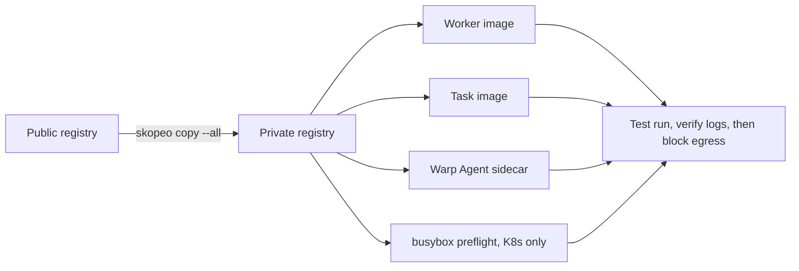

# Pulling self-hosted images from a private registry

> [[raw/docs/llms-docs-warp-dev/factories-self-hosting-private-container-registry|Raw]] · llms-txt

## Summary

The docs state that when compute hosts cannot pull from a public registry, the images used by self-hosted workers must be mirrored, so the private registry becomes the pull source for the worker process, task environment, Warp Agent sidecar and Kubernetes preflight Job. [[raw/docs/llms-docs-warp-dev/factories-self-hosting-private-container-registry#Pulling self-hosted images from a private registry|cite]] Four images are inventoried per worker pool before blocking egress: `warpdotdev/oz-agent-worker`, the task (environment or default) image, `warpdotdev/warp-agent:latest` (mounted at `/agent`) and `busybox:1.36`. [[raw/docs/llms-docs-warp-dev/factories-self-hosting-private-container-registry#Images to mirror|cite]]

Images are copied with a multi-arch-preserving tool; the example uses Skopeo (`skopeo copy --all`). [[raw/docs/llms-docs-warp-dev/factories-self-hosting-private-container-registry#Copying images into the registry|cite]] The two backends then differ in how they authenticate and pull.

## Key claims

- Pin the worker image to the immutable timestamp tag or digest from the worker release; the sidecar reference is the mutable `warpdotdev/warp-agent:latest`, so pin it by mirrored digest and refresh the mirror regularly. [[raw/docs/llms-docs-warp-dev/factories-self-hosting-private-container-registry#Images to mirror|cite]]
- The steps cover Warp Agent runs without Computer Use; Computer Use and third-party harnesses need additional images, and the docs say to contact the Warp account team before enabling them in a pool with blocked egress. [[raw/docs/llms-docs-warp-dev/factories-self-hosting-private-container-registry#Images to mirror|cite]]
- Docker backend (worker release `v2026-08-28-21-43-14` or newer): the worker's Docker config authenticates task-image pulls, but sidecar pulls use no credentials. So either pre-pull task and sidecar images and set `image_pull_policy: "Never"`, or allow anonymous reads on the sidecar repo and use `"Always"`. [[raw/docs/llms-docs-warp-dev/factories-self-hosting-private-container-registry#Configuring the Docker backend|cite]]
- The worker does not rewrite task-image registry names; the private reference must be set on the Warp environment. With `Never`, the sidecar must be re-pulled on every worker host after each mirror refresh. [[raw/docs/llms-docs-warp-dev/factories-self-hosting-private-container-registry#Configuring the Docker backend|cite]]
- Kubernetes backend: an API key Secret and a `kubernetes.io/dockerconfigjson` pull secret are created in namespace `warp-oz`; Helm values set `image.*`, `kubernetesBackend.defaultImage`, `preflightImage`, `sidecarImage`. An environment image takes precedence over `defaultImage`. [[raw/docs/llms-docs-warp-dev/factories-self-hosting-private-container-registry#Configuring the Kubernetes backend|cite]]
- `image.pullSecrets` authenticates the worker Deployment; `kubernetesBackend.podTemplate.imagePullSecrets` authenticates task Jobs and the preflight Job. The chart is packaged from the worker release on a GitHub-connected network and carried to the internal host. [[raw/docs/llms-docs-warp-dev/factories-self-hosting-private-container-registry#Configuring the Kubernetes backend|cite]]
- Verification before blocking egress: preflight Job completes, worker logs `Successfully connected to server`, an `oz agent run-cloud --host` test run succeeds, and every task Pod image uses the private registry; run with debug log and `cleanup=false`, then restore. [[raw/docs/llms-docs-warp-dev/factories-self-hosting-private-container-registry#Verifying Kubernetes registry isolation|cite]]
- Troubleshooting: Docker `pull access denied` means missing task credentials or an unauthenticated sidecar pull; Kubernetes `ImagePullBackOff` means the `warp-registry` secret is missing or placed in the wrong field. [[raw/docs/llms-docs-warp-dev/factories-self-hosting-private-container-registry#Troubleshooting|cite]]

## Notable quotes

> "Docker backend uses the worker's Docker config to authenticate task-image pulls. Warp Agent sidecar pulls do not use those credentials."
> — [[raw/docs/llms-docs-warp-dev/factories-self-hosting-private-container-registry#Configuring the Docker backend|Docker backend]]

## Connections

- **Entities**: [[wiki/entities/warp-factories]], [[wiki/entities/docker]], [[wiki/entities/kubernetes]], [[wiki/entities/github]]
- **Concepts**: [[wiki/concepts/self-hosting]], [[wiki/concepts/agent-runner]], [[wiki/concepts/secrets-management]]

> Synthesis: Air-gapped operations runbook for Warp's self-hosted workers; the notable constraint is the unauthenticated sidecar pull on Docker, which forces pre-pulling or anonymous reads, and it is vendor guidance rather than independent evidence.
