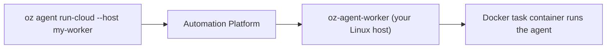

# Self-hosting quickstart

> [[raw/docs/llms-docs-warp-dev/factories-self-hosting-quickstart|Raw]] · llms-txt

## Summary

This vendor docs page is a hands-on tutorial for the default self-hosting path of Warp Factories. The docs state that the "managed architecture" splits duties: the Automation Platform orchestrates the agent, while a worker on the user's own infrastructure supplies the compute, here via the Docker backend. [[raw/docs/llms-docs-warp-dev/factories-self-hosting-quickstart#Self-hosting quickstart|cite]]

The flow has four steps: export an Agent API key, start the `oz-agent-worker` container with the Docker socket mounted, route a run with `oz agent run-cloud --host`, and verify the run in the cloud agent dashboard. The page ends with troubleshooting for three failure modes (worker won't start, won't connect, task stays queued) and links to the overview and full Docker setup. [[raw/docs/llms-docs-warp-dev/factories-self-hosting-quickstart#Run your first self-hosted agent|cite]]

## Key claims

- The docs state prerequisites: an Agent API key tied to the Default Service Account, a Linux machine with a rootful Docker daemon and GNU `stat`, and the Oz CLI on the routing machine. [[raw/docs/llms-docs-warp-dev/factories-self-hosting-quickstart#Prerequisites|cite]]
- The same Agent key is used for both the worker container and `oz agent run-cloud`; a self-hosted worker key authenticates the worker only. [[raw/docs/llms-docs-warp-dev/factories-self-hosting-quickstart#1\ Export your API key|cite]]
- The worker mounts `/var/run/docker.sock` so it can spawn task containers; `--worker-id` is a team-chosen name used to route tasks. [[raw/docs/llms-docs-warp-dev/factories-self-hosting-quickstart#2\ Start the worker|cite]]
- Routing is by `--host` matching `--worker-id`; runs move `QUEUED`, `INPROGRESS`, `SUCCEEDED` in the dashboard, and sessions can be attached via Agent Session Sharing to monitor or steer. [[raw/docs/llms-docs-warp-dev/factories-self-hosting-quickstart#3\ Route a run to your worker|cite]]
- For production, the docs advise pinning the image by digest rather than `latest`. [[raw/docs/llms-docs-warp-dev/factories-self-hosting-quickstart#2\ Start the worker|cite]]
- Troubleshooting: workers need `linux/amd64` or `linux/arm64` (no musl/Alpine), outbound access to `oz.warp.dev:443`, and an exact, case-sensitive `--host` match on the same team. [[raw/docs/llms-docs-warp-dev/factories-self-hosting-quickstart#Troubleshooting|cite]]
- An unmanaged, CLI-only alternative runs `oz agent run` directly on any host without Docker. [[raw/docs/llms-docs-warp-dev/factories-self-hosting-quickstart#Self-hosting quickstart|cite]]

## Notable quotes

> "Run your first cloud agent on your own infrastructure in ~10 minutes using the managed architecture with the Docker backend — the default and fastest path to self-hosting."
> — [[raw/docs/llms-docs-warp-dev/factories-self-hosting-quickstart#Self-hosting quickstart|intro]]

## Connections

- **Entities**: [[wiki/entities/warp-factories]], [[wiki/entities/docker]]
- **Concepts**: [[wiki/concepts/self-hosting]], [[wiki/concepts/agent-runner]], [[wiki/concepts/secrets-management]]

> Synthesis: Narrow how-to for one self-hosting backend; it shows the worker as the runner abstraction behind Factories and shows API-key handling, but gives no design rationale beyond the vendor's own framing.
