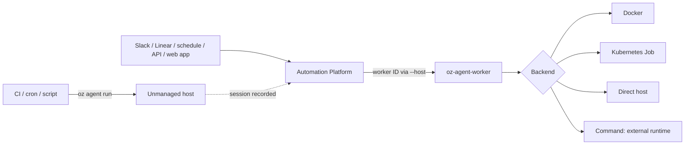

# Self-hosting overview

> [[raw/docs/llms-docs-warp-dev/factories-self-hosting|Raw]] · llms-txt

## Summary

This is vendor documentation. The docs state that self-hosting runs cloud agent workloads on your infrastructure: you control compute, network access, runtime secrets and execution workspaces, while Warp tracks each run. It requires an Enterprise plan. [[raw/docs/llms-docs-warp-dev/factories-self-hosting#Self-hosting overview|cite]]

The page splits the design in two by who starts the run. In the managed architecture, the Automation Platform routes work to a long-lived `oz-agent-worker`, which picks a backend per task. In the unmanaged architecture, your CI, cron or script calls `oz agent run` and Warp only records the session. [[raw/docs/llms-docs-warp-dev/factories-self-hosting#Managed and unmanaged architectures|cite]] The docs suggest mixing both, for example Slack-triggered work on a managed worker and CI-driven agents unmanaged.

## Key claims

- Managed backends are Docker (default), Kubernetes (one Job per task), Direct (host process), Command (hands the task to an external job API or queue) and one-shot Direct (an external scheduler starts one Direct worker per task). [[raw/docs/llms-docs-warp-dev/factories-self-hosting#Choosing a managed backend|cite]]
- Workers need only outbound network access to Warp, no inbound ports. Worker credentials are a self-hosted worker API key, to be kept in a secret manager and passed as `WARP_API_KEY` or `--api-key`. [[raw/docs/llms-docs-warp-dev/factories-self-hosting#Managed prerequisites|cite]]
- Runs, schedules and integrations are routed by setting the host to the worker ID (`--host`, or `config.worker_host` in the API). Several long-lived workers can share an ID for load balancing; each one-shot Direct job needs a unique ID. [[raw/docs/llms-docs-warp-dev/factories-self-hosting#Managed architecture|cite]]
- Unattended run creation uses an agent API key tied to the Default Service Account. The worker and the run creator may use separate key types. [[raw/docs/llms-docs-warp-dev/factories-self-hosting#Routing runs to self-hosted workers|cite]]
- Host choice is independent of the environment: the same environment can run Warp-hosted or self-hosted. [[raw/docs/llms-docs-warp-dev/factories-self-hosting#Routing runs to self-hosted workers|cite]]
- A smoke test needs no factory or environment: submit `oz agent run-cloud` with `--no-environment`, then poll `oz run get` until `state` is `SUCCEEDED` and read the conversation. A run ID alone does not confirm success. [[raw/docs/llms-docs-warp-dev/factories-self-hosting#Validating your setup without a factory|cite]]
- Repository clones and workspaces stay on your infrastructure, but agent context and model requests still travel through Warp services. Workers can export OpenTelemetry metrics. [[raw/docs/llms-docs-warp-dev/factories-self-hosting#Security and observability|cite]]

## Notable quotes

> "Self-hosting runs cloud agent workloads on your infrastructure. You control the compute, network access, runtime secrets, and execution workspaces while Warp tracks each run."
> — [[raw/docs/llms-docs-warp-dev/factories-self-hosting#Self-hosting overview|Self-hosting overview]]

> "Repository clones and execution workspaces stay on your infrastructure. Agent context and model requests still travel through Warp's services."
> — [[raw/docs/llms-docs-warp-dev/factories-self-hosting#Security and observability|Security and observability]]

## Connections

- **Entities**: [[wiki/entities/warp-factories]], [[wiki/entities/docker]], [[wiki/entities/kubernetes]], [[wiki/entities/slack]], [[wiki/entities/linear]]
- **Concepts**: [[wiki/concepts/self-hosting]], [[wiki/concepts/agent-runner]], [[wiki/concepts/secrets-management]]

> Synthesis: Overview and routing hub for the self-hosting subtree of the Warp docs; the child pages (quickstart, backends, reference, troubleshooting) hold the detail, and the trust boundary is only partial since model traffic still passes through Warp.
