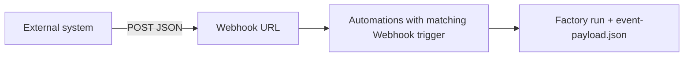

# Triggering automations with custom webhooks

> [[raw/docs/llms-docs-warp-dev/factories-webhooks|Raw]] · llms-txt

## Summary

The docs state that a custom webhook gives a factory an HTTPS URL that any external system (internal CI, Vercel, Stripe, Sentry, PagerDuty, homegrown tools) can POST JSON to. An automation with a **Webhook** trigger subscribes to it and starts a run when a delivery matches its filter. This covers tools Warp does not integrate with directly. [[raw/docs/llms-docs-warp-dev/factories-webhooks#How custom webhooks work|cite]]

The page walks through setup: create the webhook in the dashboard (name, auth mode, secret name, optional delivery ID header), configure the sender, add a Webhook trigger to an automation, optionally add a payload filter, and use **Test filter** to check it against a stored delivery. It then covers management (delivery log, enable toggle, secret rotation, delete), the delivery contract, a definitions-as-code form, and troubleshooting.

Security is a recurring theme: the secret is shown once, the run envelope marks the payload as untrusted so injected instructions do not redirect the run, and a URL-token webhook's URL is itself a credential.

## Key claims

- Three auth modes exist: bearer token (default, `token`), URL token (`url_token`, secret in the path) and provider signature (`signature`, for Vercel, Stripe, GitHub, Sentry, PagerDuty and Standard Webhooks senders). [[raw/docs/llms-docs-warp-dev/factories-webhooks#Authentication modes|cite]]
- Payload filters are JSON objects mirroring the body: arrays list allowed values, all keys must match, and operators `in`, `not_in` and `exists` are supported. Without a filter, every delivery starts a run. [[raw/docs/llms-docs-warp-dev/factories-webhooks#Filter deliveries by payload|cite]]
- A run gets the automation's prompt plus an envelope naming the webhook and delivery ID, with the full body attached as `event-payload.json`; embedded content is declared untrusted. [[raw/docs/llms-docs-warp-dev/factories-webhooks#What the run receives|cite]]
- Delivery contract: POST only, body at most 256 KB, `202` on accept (even if nothing matches), `401`/`400`/`404`/`413`, and `429` above 60 deliveries per minute; max 20 webhooks per factory. [[raw/docs/llms-docs-warp-dev/factories-webhooks#Delivery rules|cite]]
- Duplicates are detected by delivery identity (named header, provider header, `X-Warp-Delivery-Id`, then body hash), so provider retries start no duplicate runs. No ordering guarantee between deliveries. [[raw/docs/llms-docs-warp-dev/factories-webhooks#Delivery rules|cite]]
- Rotating a secret invalidates the old one immediately; for zero downtime, create a second webhook, move the sender, delete the first. Delivery history keeps at least 50 deliveries and 7 days. [[raw/docs/llms-docs-warp-dev/factories-webhooks#Manage webhooks|cite]]
- In a factory definition, a webhook is `webhooks/<name>.yaml` pointing at a managed secret; automations subscribe with a `webhook` trigger whose `webhook_ids` holds one Warp-assigned UID. [[raw/docs/llms-docs-warp-dev/factories-webhooks#Webhooks in definitions as code|cite]]

## Notable quotes

> "A `202` means the delivery was accepted for evaluation, not that an automation fired: a delivery that matches nothing is still accepted and logged."
> — [[raw/docs/llms-docs-warp-dev/factories-webhooks#Delivery rules|Delivery rules]]

## Connections

- **Entities**: [[wiki/entities/warp-factories]], [[wiki/entities/vercel]], [[wiki/entities/sentry]], [[wiki/entities/github]]
- **Concepts**: [[wiki/concepts/webhook]], [[wiki/concepts/secrets-management]], [[wiki/concepts/factory-as-code]]

> Synthesis: Vendor doc for the generic event-ingress path into Warp Factories; it complements the first-party integrations (Slack, GitHub, Linear) by letting any system start agent work, with prompt-injection and dedup handled at the platform layer.
