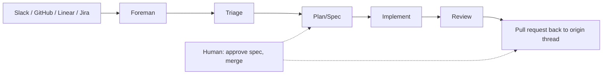

# Warp Factories overview

> [[raw/docs/llms-docs-warp-dev/factories|Raw]] · llms-txt

## Summary

This is the landing page of the Warp Factories docs. The docs state that a factory is a team of cloud agents connected to your repositories. It routes work from Slack, GitHub, Linear or Jira through triage, planning, implementation and review, and returns the output (usually a pull request) to the thread or issue where the work began. [[raw/docs/llms-docs-warp-dev/factories#Warp Factories overview|cite]]

The page names the product's parts: work items (one request, keeping its source context end to end), a foreman agent that coordinates and talks to humans, stage agents, a declarative factory definition, work sources, execution, and measurement tooling. The docs frame the lifecycle as a loop: triage, spec, implement, review, verify, ship, monitor, with human checkpoints for spec, code and product. [[raw/docs/llms-docs-warp-dev/factories#Stages and checkpoints|cite]]

Being vendor documentation, everything below is the vendor's own account, not independent evidence.

## Key claims

- The docs state the foreman may skip unneeded stages or send work back for revision, and that spec approval is part of the foreman's editable instructions, not a repository permission. [[raw/docs/llms-docs-warp-dev/factories#Stages and checkpoints|cite]]
- The docs state the factory never merges on the user's behalf; repository permissions and branch protection govern approval and merge. [[raw/docs/llms-docs-warp-dev/factories#Stages and checkpoints|cite]]
- The docs state a factory's repositories, agents, automations, runners, skills and MCP servers are declared in definition files, Warp-managed or kept in a team-owned GitHub repo where changes go through PR review. [[raw/docs/llms-docs-warp-dev/factories#Factory definition|cite]]
- Supported work sources are Slack, Microsoft Teams, GitHub, GitLab, Azure DevOps, Linear and Jira; custom webhooks, factory endpoints and scheduled automations cover other cases. A Factory MCP lets a local coding agent hand work to a factory and take it back. [[raw/docs/llms-docs-warp-dev/factories#Work sources|cite]]
- Runs execute on Warp-hosted compute by default; Enterprise teams can use managed self-hosting to keep checkout and execution on their own infrastructure. [[raw/docs/llms-docs-warp-dev/factories#Execution|cite]]
- Improvement tooling per the docs: a dashboard (PR activity, autonomy, cycle time, cost), scorers that classify runs, benchmarks that compare configurations on the same tasks, and self-improvement that proposes changes for review. [[raw/docs/llms-docs-warp-dev/factories#Evaluate and improve factory work|cite]]
- Sizing guidance: group repositories that ship together into one factory, separate products into separate factories, and specialize with custom agents and skills rather than splitting repos by team. [[raw/docs/llms-docs-warp-dev/factories#Sizing a factory|cite]]

## Notable quotes

> "The foreman is the agent that coordinates a factory's work and communicates with you."
> — [[raw/docs/llms-docs-warp-dev/factories#Foreman and factory agents|location]]

> "The factory never merges on your behalf."
> — [[raw/docs/llms-docs-warp-dev/factories#Stages and checkpoints|location]]

## Connections

- **Entities**: [[wiki/entities/warp-factories]], [[wiki/entities/slack]], [[wiki/entities/github]], [[wiki/entities/linear]], [[wiki/entities/jira]], [[wiki/entities/gitlab]], [[wiki/entities/azure-devops]], [[wiki/entities/microsoft-teams]]
- **Concepts**: [[wiki/concepts/software-factory]], [[wiki/concepts/human-in-the-loop]], [[wiki/concepts/factory-as-code]], [[wiki/concepts/self-hosting]], [[wiki/concepts/mcp]], [[wiki/concepts/agent-evals]], [[wiki/concepts/agent-skill]], [[wiki/concepts/webhook]], [[wiki/concepts/multi-repo-development]]

> Synthesis: Product-level entry point of the Warp docs set; a concrete vendor implementation of the software-factory idea with human gates at spec and merge, and the hub the sibling Warp pages detail.
