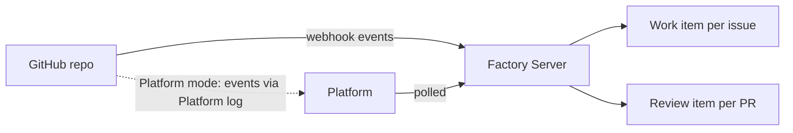

# GitHub

> [[raw/docs/llms-factory-mastra-ai/configure-github|Raw]] · llms-txt · Mastra Factory docs, Configuration

## Summary

This configuration page explains how GitHub supplies the repository, issues and pull requests that Factory works on. Most users install the Mastra GitHub App during onboarding (the "Platform-backed" connection) and then pick repositories. [[raw/docs/llms-factory-mastra-ai/configure-github#Connect the repository|cite]] Teams that want control can instead register their own GitHub App and supply it through `GITHUB_APP_*` environment variables on the Factory Server. [[raw/docs/llms-factory-mastra-ai/configure-github#Use your own GitHub App|cite]]

Intake is deliberately simple: each issue in a selected repository becomes one Work item, pull requests become Review items, and GitHub hierarchy (epics, sub-issues) is ignored. Only issues opened after the repository is connected are picked up, so an existing backlog stays out. [[raw/docs/llms-factory-mastra-ai/configure-github#Factory syncs individual issues|cite]]

## Key claims

- Two connection modes exist and only one is active: the Platform-backed App, or your own App selected by a complete `GITHUB_APP_*` group. If any of the first five variables is missing, Factory falls back to Platform when credentials exist. [[raw/docs/llms-factory-mastra-ai/configure-github#Use your own GitHub App|cite]]
- Required App permissions: Contents write (clone, push session branches), Issues write, Pull requests write, Metadata read. No organization permissions are needed. [[raw/docs/llms-factory-mastra-ai/configure-github#Repository permissions|cite]]
- Subscribed webhook events are `issues`, `issue_comment`, `pull_request`, `pull_request_review` and `pull_request_review_comment`; other events are ignored, and CI check results never wake a session. [[raw/docs/llms-factory-mastra-ai/configure-github#Webhook events|cite]]
- Self-owned Apps receive webhooks at `<public origin>/web/github/webhook`; in Platform mode GitHub delivers to Platform and Factory polls its event log. [[raw/docs/llms-factory-mastra-ai/configure-github#Webhook delivery|cite]]
- App installation tokens do not work for `gh` inside a sandbox (`Resource not accessible by integration`). A classic personal access token saved under Settings, Repositories, GitHub CLI tokens becomes the sandbox `GH_TOKEN`. An optional reviewer token keeps PR reviews from a different account than the author. [[raw/docs/llms-factory-mastra-ai/configure-github#Sandbox command line access|cite]]
- The only parent-child link Factory tracks is between a PR's Review item and the Work item for the issue it addresses. [[raw/docs/llms-factory-mastra-ai/configure-github#Factory syncs individual issues|cite]]

## Notable quotes

> "Factory syncs issues, not your GitHub structure."
> — [[raw/docs/llms-factory-mastra-ai/configure-github#Factory syncs individual issues|Factory syncs individual issues]]

## Connections

- **Entities**: [[wiki/entities/github]]
- **Concepts**: none

> Synthesis: Operational setup page for one integration; it shows Factory treating GitHub as flat issue/PR intake with per-teammate selection, and the sandbox token caveat is the practical gotcha.
