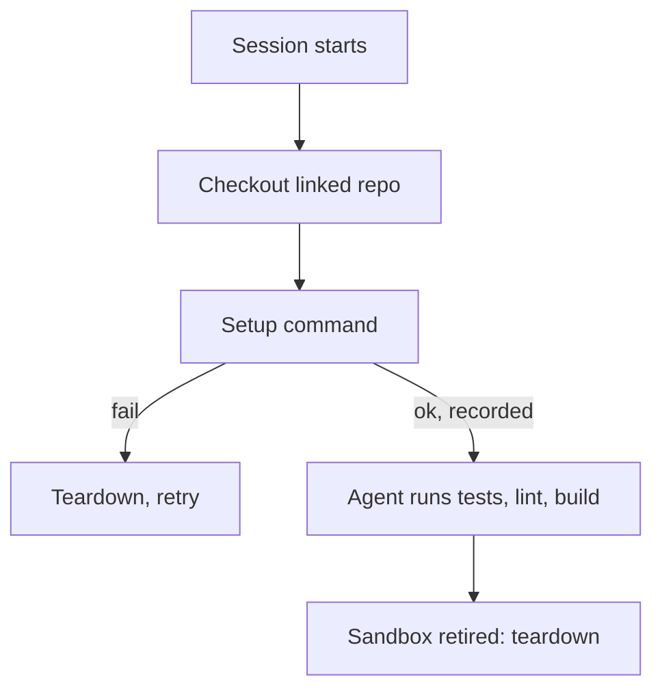

# Sandboxes

> [[raw/docs/llms-factory-mastra-ai/configure-sandboxes|Raw]] · llms-txt

## Summary

This Mastra Factory configuration page treats the sandbox as the per-session environment where a coding agent gets its repository checkout, dependencies and command execution. [[raw/docs/llms-factory-mastra-ai/configure-sandboxes#Sandboxes|cite]] Every session starts by checking out the linked repository; the operator sets a per-repository **setup** command (for example `pnpm i && pnpm build`) and an optional **teardown** command in Settings. [[raw/docs/llms-factory-mastra-ai/configure-sandboxes#Prepare the repository|cite]]

Providers are chosen in code: a `sandbox` callback in `src/mastra/sandbox.ts` returns a `PlatformSandbox` (cloud, Mastra platform), a `LocalSandbox` (runs on the Factory Server machine), or another Mastra sandbox provider, and is passed into `new MastraFactory(...)`. [[raw/docs/llms-factory-mastra-ai/configure-sandboxes#Set the sandbox|cite]] The sandbox config is therefore TypeScript, not a UI toggle.

The page is candid about limits: cloud sandboxes are remote VMs with no device, specific OS or simulator (e.g. iOS), so such checks belong in CI or a local sandbox on a suitable machine. [[raw/docs/llms-factory-mastra-ai/configure-sandboxes#Testing limits|cite]]

## Key claims

- Setup runs when the sandbox first starts; success is recorded so warm restarts skip it. On failure, teardown runs before retry, and again on retirement. [[raw/docs/llms-factory-mastra-ai/configure-sandboxes#Prepare the repository|cite]]
- The agent runs the repository's own test, lint and build commands in the sandbox, so setup must install what they need. [[raw/docs/llms-factory-mastra-ai/configure-sandboxes#Prepare the repository|cite]]
- `PlatformSandbox` needs `MASTRA_PLATFORM_ACCESS_TOKEN`, `MASTRA_PROJECT_ID`, `MASTRA_ENVIRONMENT_ID` locally; platform deployments supply them from the environment. [[raw/docs/llms-factory-mastra-ai/configure-sandboxes#Mastra platform|cite]]
- `LocalSandbox` gives each session its own working directory but no VM isolation; root is set via `MASTRACODE_LOCAL_SANDBOX_ROOT`. [[raw/docs/llms-factory-mastra-ai/configure-sandboxes#Local execution|cite]]
- Default generated callback fallback order: local if `FACTORY_SANDBOX_PROVIDER=local`; else Mastra platform if credentials set; else E2B if `E2B_API_KEY`; else local. [[raw/docs/llms-factory-mastra-ai/configure-sandboxes#Check the selected provider|cite]]
- Startup is lazy: the first code command starts the environment. [[raw/docs/llms-factory-mastra-ai/configure-sandboxes#Check the selected provider|cite]]

## Notable quotes

> "Cloud sandboxes are remote virtual machines managed by Mastra platform. They don't provide hardware or a local operating system, so checks that need a device, a specific OS, or a simulator such as iOS don't run in Factory."
> — [[raw/docs/llms-factory-mastra-ai/configure-sandboxes#Testing limits|Testing limits]]

## Connections

- **Entities**: none
- **Concepts**: [[wiki/concepts/dev-environment]], [[wiki/concepts/factory-as-code]], [[wiki/concepts/agent-harness]]

> Synthesis: Mastra's sandbox is the per-session dev environment of a software factory, configured as code, with an explicit local-vs-cloud isolation trade-off.
