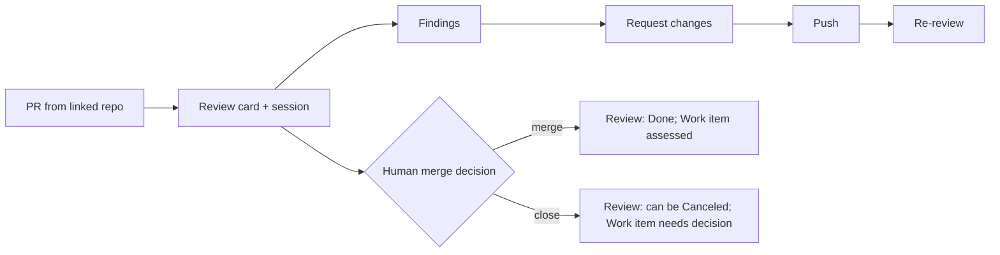

# Review items

> [[raw/docs/llms-factory-mastra-ai/using-reviews|Raw]] · llms-txt

## Summary

This docs page describes **Review**, the part of Mastra's Factory that follows a pull request through agent review and human assessment. Each PR gets its own Review card with its own session, even when Factory created the PR from an existing Work item. [[raw/docs/llms-factory-mastra-ai/using-reviews#Review items|cite]]

The flow has three parts. You find the PR, check its GitHub link, base branch and changes, start the review if the card is waiting, and inspect findings, tool output and tests next to the real diff. You then request concrete changes; for PRs Factory authored, changes-requested feedback can reach the authoring Work session. After a push, **Re-review** runs another pass, and a newer pass can supersede an active one. [[raw/docs/llms-factory-mastra-ai/using-reviews#Start and inspect a review|cite]] [[raw/docs/llms-factory-mastra-ai/using-reviews#Respond to feedback|cite]]

The page keeps agent output and human decisions apart. A finished review run means only that the agent finished reviewing. The merge decision belongs to the repository's normal human review process, and closing the linked issue is a separate step. [[raw/docs/llms-factory-mastra-ai/using-reviews#Finish or close a review|cite]]

## Key claims

- Factory pulls PRs from the linked repository into Review; a missing PR points to a wrong repository link or a broken GitHub connection. [[raw/docs/llms-factory-mastra-ai/using-reviews#Start and inspect a review|cite]]
- A completed review run means the agent finished; merging the PR and completing the original issue are separate steps. [[raw/docs/llms-factory-mastra-ai/using-reviews#Start and inspect a review|cite]]
- Merging a PR moves the Review card to Done, while the Work item assesses whether the task is complete, since a task can span several PRs. [[raw/docs/llms-factory-mastra-ai/using-reviews#Finish or close a review|cite]]
- Closing without merging can move the card to Canceled, but the underlying task still needs a decision. [[raw/docs/llms-factory-mastra-ai/using-reviews#Finish or close a review|cite]]
- Pushing more changes to an open PR may require another review. [[raw/docs/llms-factory-mastra-ai/using-reviews#Finish or close a review|cite]]
- Reviewers should check acceptance criteria and required checks before merging. [[raw/docs/llms-factory-mastra-ai/using-reviews#Finish or close a review|cite]]

## Notable quotes

> "When a review run completes, the agent has finished its review. Merging the PR and completing the original issue are separate steps."
> — [[raw/docs/llms-factory-mastra-ai/using-reviews#Start and inspect a review|Start and inspect a review]]

## Connections

- **Entities**: [[wiki/entities/github]]
- **Concepts**: [[wiki/concepts/human-in-the-loop]]

> Synthesis: Short product-docs page; its useful idea is that agent review output never decides merge or issue closure, a human-in-the-loop gate that other Factory docs pages likely repeat.
