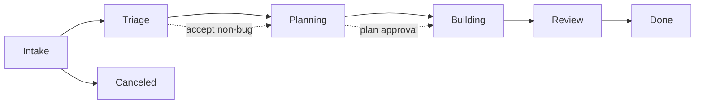

# Work items

> [[raw/docs/llms-factory-mastra-ai/using-work-and-approvals|Raw]] · llms-txt

## Summary

This page explains the **Work** board in Mastra Factory. A Work card tracks an issue or task from intake to completion. A PR gets its own card on the separate **Review** board: judge the task outcome on the Work card, the PR on the Review card. [[raw/docs/llms-factory-mastra-ai/using-work-and-approvals#Work items|cite]]

The core design is a phase pipeline (Intake, Triage, Planning, Building, Review, Done, Canceled) where each phase pairs an agent activity with a human next action. Humans authorize transitions through explicit decisions: start a proposed run, accept a task, approve a plan, merge a PR. Two board toggles, **Auto-start runs** and **Auto-approve plans**, control how much runs without a person. [[raw/docs/llms-factory-mastra-ai/using-work-and-approvals#Understand the phases|cite]]

The page ends with a table of source events. GitHub and Linear state changes move Work cards to Done or Canceled, and a PR merge moves its Review card to Done. Event delivery and reconciliation are asynchronous. [[raw/docs/llms-factory-mastra-ai/using-work-and-approvals#Understand source events|cite]]

## Key claims

- Non-bug items need recorded human acceptance before planning or building, and the built-in policy checks this even if the item passed through another intermediate phase. [[raw/docs/llms-factory-mastra-ai/using-work-and-approvals#Make the right decision|cite]]
- Built-in Planning writes a plan in the session, then requests a transition to Building via `factory_transition_work_item`. This is separate from the interactive `submit_plan` approval flow. [[raw/docs/llms-factory-mastra-ai/using-work-and-approvals#Make the right decision|cite]]
- **Auto-approve plans** answers `submit_plan` requests only. It does not approve stage-transition requests. [[raw/docs/llms-factory-mastra-ai/using-work-and-approvals#Choose automation settings|cite]]
- With both automation toggles off, Factory never starts agent work or spends model tokens on its own. [[raw/docs/llms-factory-mastra-ai/using-work-and-approvals#Choose automation settings|cite]]
- Default GitHub rules allow an automatic initial run only if the issue was created after the Factory and the author has write or admin access. [[raw/docs/llms-factory-mastra-ai/using-work-and-approvals#Choose automation settings|cite]]
- GitHub issue closed as completed moves the Work card to Done. Closed as not planned or duplicate moves it to Canceled. Linear completed or canceled maps likewise. [[raw/docs/llms-factory-mastra-ai/using-work-and-approvals#Understand source events|cite]]
- A merged PR moves its Review card to Done and prompts the originating Work session to assess completion before marking the task Done. [[raw/docs/llms-factory-mastra-ai/using-work-and-approvals#Understand source events|cite]]

## Notable quotes

> "Keep both controls off while learning the workflow."
> — [[raw/docs/llms-factory-mastra-ai/using-work-and-approvals#Choose automation settings|Choose automation settings]]

> "The original Work item tracks completion of the task, not the PR."
> — [[raw/docs/llms-factory-mastra-ai/using-work-and-approvals#Understand source events|Understand source events]]

## Connections

- **Entities**: [[wiki/entities/github]], [[wiki/entities/linear]]
- **Concepts**: [[wiki/concepts/human-in-the-loop]]

> Synthesis: Concrete human-in-the-loop gating design (acceptance, plan approval, trust-based auto-start) for Mastra Factory, separating task outcome from PR review.
