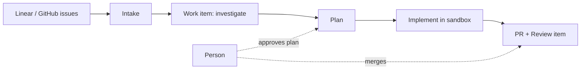

# What's Factory?

> [[raw/docs/llms-factory-mastra-ai/what-is-factory|Raw]] · llms-txt

## Summary

This is the intro page of the Mastra Factory docs. The docs describe Mastra Factory as a web application for working with coding agents: connect a repository, pull issues onto a work board, and guide a change through investigation, planning, implementation and pull request review. The advice is to start with one issue and keep control of the decisions at each phase. [[raw/docs/llms-factory-mastra-ai/what-is-factory#What's Factory?|cite]]

The Factory project (server configuration) is kept separate from the target repository. Factory clones the target into an isolated sandbox per session, changes it there and opens pull requests; it never edits the local checkout. The product bundles a Factory Server (web UI, coordination), auth, sandboxes and storage, and works with the user's choice of model provider. GitHub supplies repositories and issues and receives PRs; Linear can supply issues; Slack and web or mobile browsers are the user surfaces. [[raw/docs/llms-factory-mastra-ai/what-is-factory#Understand the pieces|cite]]

Being vendor documentation, everything here is the vendor's own account.

## Key claims

- Three deployment setups: fully on Mastra platform; local server with platform-provided auth, storage and sandboxes; fully self-hosted with own providers. Auth, storage and sandboxes can be configured independently of the server location, and new projects default to platform services. [[raw/docs/llms-factory-mastra-ai/what-is-factory#Where Factory runs|cite]]
- Vocabulary: Factory project, target repository, platform project, Factory (a codebase with its settings, work and sessions), Intake, Work item, Review item, Session. A Work item and the PR's Review item have separate completion rules. [[raw/docs/llms-factory-mastra-ai/what-is-factory#Understand Factory terms|cite]]
- Factory acts on its own to sync issues, propose investigations and move cards on source events. [[raw/docs/llms-factory-mastra-ai/what-is-factory#Follow a change|cite]]
- Four steps always wait for a person: starting a run (unless Auto-start runs is on and the item is eligible), accepting a non-bug task, approving a plan (unless Auto-approve plans is on), and merging a PR. [[raw/docs/llms-factory-mastra-ai/what-is-factory#Follow a change|cite]]
- Progress is visible on the Overview page, in session transcripts and in the Audit log. [[raw/docs/llms-factory-mastra-ai/what-is-factory#Follow a change|cite]]
- Models come from a provider API key or a supported subscription. [[raw/docs/llms-factory-mastra-ai/what-is-factory#Understand the pieces|cite]]

## Notable quotes

> "It never edits your local checkout."
> — [[raw/docs/llms-factory-mastra-ai/what-is-factory#What's Factory?|location]]

> "Factory acts on its own for some steps and waits for a person on others."
> — [[raw/docs/llms-factory-mastra-ai/what-is-factory#Follow a change|location]]

## Connections

- **Entities**: [[wiki/entities/mastra-factory]], [[wiki/entities/github]], [[wiki/entities/linear]], [[wiki/entities/slack]]
- **Concepts**: [[wiki/concepts/software-factory]], [[wiki/concepts/human-in-the-loop]], [[wiki/concepts/self-hosting]]

> Synthesis: Entry page of the Mastra Factory docs; a second vendor take on the software-factory idea, with a board-and-approvals model (plan approval, merge) where Warp Factories uses a foreman agent, and optional auto-approve toggles for the human gates.
