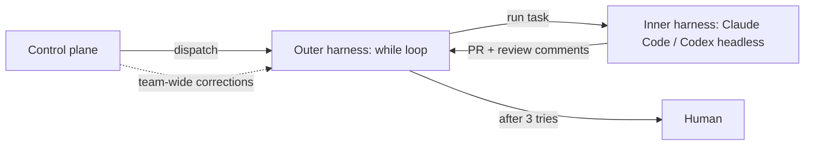

# Inner and outer harness

The wiki has no page for "inner loop" and "outer loop" as named terms. The nearest
idea is the **inner and outer harness**, from the Boundary podcast. [[wiki/sources/youtube-tGbjIvvYuHE]]

## The split

The podcast puts the harness as one layer of a four-layer software-factory stack:
compute, dev environment, harness, control plane. It splits the harness into two
parts. [[wiki/concepts/software-factory]], [[wiki/concepts/agent-harness]]

- **Inner harness**: the coding agent itself, such as Claude Code or Codex. It
  runs the model with tools on one task. [[wiki/concepts/agent-harness]], [[wiki/entities/claude-code]]
- **Outer harness**: the code around the agent. It decides when to run the agent
  again, when to stop and when to ask a human. [[wiki/concepts/agent-harness]]

## Worked example: Boundary's factory

Boundary's factory ("agent tries BAML") runs Claude Code or Codex headless as the
inner harness. Hard-coded while loops are the outer harness. One loop fixes
CodeRabbit comments until the PR is mergeable. It stops after 3 iterations and
asks a human. [[wiki/concepts/agent-harness]], [[wiki/entities/claude-code]]

## How the outer harness improves

The control plane feeds team-wide corrections back into the outer harness. The
podcast calls this "compounding engineering". [[wiki/concepts/control-plane]]

## Other vendors

Warp has one `harness` field per agent (Warp Agent, Claude Code or Codex). That
field is roughly the inner harness. Warp's foreman and stage agents do the
outer-harness job of staging, loops and dispatch. Factory treats its Droid runtime
as the whole harness, with Missions as an orchestrator over workers. [[wiki/concepts/agent-harness]]

The podcast says to own the outer harness. Warp offers a managed foreman pipeline
instead. [[wiki/concepts/agent-harness]]

> Synthesis: The general dev-tooling sense of "inner loop" (local edit-build-test) versus "outer loop" (CI, review, deploy) is not in any ingested source; a source that defines it would extend or revise this note.
