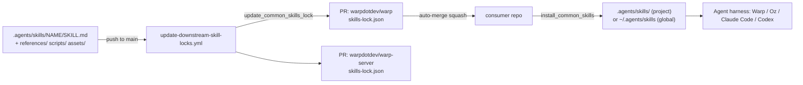
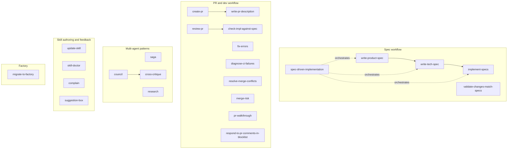
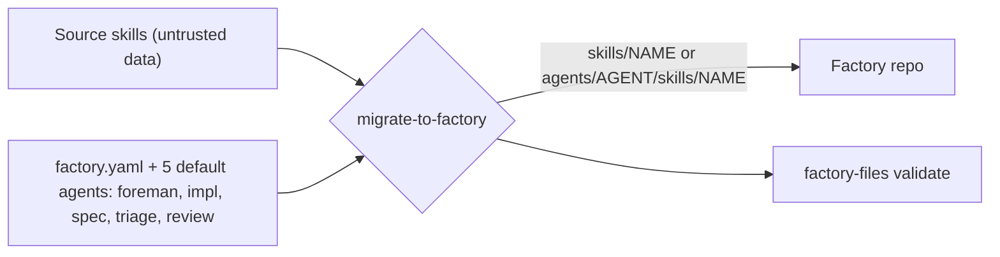
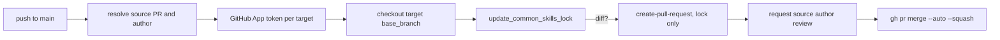

# common-skills — Architecture

> Clone: `raw/repos/.github-warpdotdev-common-skills/` · [warpdotdev/common-skills](https://github.com/warpdotdev/common-skills) @ `8792394`

> Scope: repo layout, the skill format, skill groups, the install/lock/propagate toolchain. Individual skill bodies were skimmed (frontmatter, headings, key sections), not read line by line. Not read: `skill-doctor` scorers/assets, `readout` and `pr-walkthrough` templates, `write-feature-docs` body, `evals/*.json`.

## 1. Bird's-eye view

Almost no application code. The repo is a content library: one directory per skill under `.agents/skills/<name>/`, each anchored by a `SKILL.md` with YAML frontmatter (`name`, `description`). The `description` is the trigger text a harness matches against the user request. Heavy material goes in optional `references/`, `scripts/`, `assets/` so the `SKILL.md` body stays short (progressive disclosure).

Second half is a distribution system: bash scripts in `scripts/` install skills into consumer repos through the `skills` npm CLI, pin them in a consumer `skills-lock.json`, and a GitHub Actions workflow opens lockfile PRs downstream on every merge to `main`. Many skills assume Warp's `warp` repo, so the README says they are mid-generalization.



## 2. Layout

- `.agents/skills/<name>/SKILL.md` — 27 skills; the only required file per skill.
- `.agents/skills/<name>/scripts|references|assets|evals|scorers` — optional bundled resources.
- `scripts/` — `resolve_common_skills`, `install_common_skills`, `update_common_skills_lock`, `remove_common_skills`, plus `README.md` and `AGENTS.md`.
- `.github/workflows/update-downstream-skill-locks.yml` — downstream propagation.
- `README.md` — skill catalogue, install usage, generalization policy.

Skill format spec: [README.md L7-L22](https://github.com/warpdotdev/common-skills/blob/8792394ff1b655e0af451b8fabb68ef0cfcbd208/README.md#L7-L22). The `.agents/skills/` directory is the cross-harness convention (Claude Code reaches it via symlink; see [[wiki/concepts/agent-skill]]).

## 3. Skill groups (components)



Also present: `brandalf`, `readout`, `reproduce-bug-report`, `write-feature-docs`, and `scan-new-specs` (deprecated and retired 2026-08-20).

- **Spec workflow.** PRODUCT.md (behaviour) then TECH.md (implementation), then `implement-specs` keeps specs and code aligned in one PR; `validate-changes-match-specs` closes the loop after.
- **PR workflow, headless.** `review-pr` is written for CI: it reads `pr_diff.txt` / `pr_description.txt`, writes `review.json` (schema, severity labels, diff-line annotations `[OLD:n]` / `[NEW:n]`) and never posts to GitHub; a workflow publishes it. It expects optional consumer companion skills (`review-pr-local`, `security-review-pr`) that specialise but may not change the output contract. `check-impl-against-spec` activates only when `spec_context.md` exists (materialised by `review-pr/scripts/resolve_spec_context.py`).
- **Orchestration patterns.** `saga`: orchestrator plus worker subagents; spec tree in `~/.sagas/<name>/` (`SAGA.md`, `PROGRESS.md`, `milestones/NN/tasks/NN.md`) so state survives context compaction; three phases (plan with user approval, worker loop, final validation with user), a deliberate [[wiki/concepts/human-in-the-loop]] shape. `council`: model-diverse subagents on one question. `cross-critique`: second round, each author critiques the others. `research`: delegate noisy reading to a subagent to keep orchestrator context clean.
- **Skill authoring loop.** `update-skill` (format guidance); `skill-doctor` scores local conversation transcripts on four rubrics (efficiency, code-quality, procedure-compliance, verbosity) and drafts SKILL.md edits; local-only, never uploads transcripts. See [[wiki/concepts/agent-evals]].
- **Agent feedback channel.** `complain` and `suggestion-box` have agents autonomously submit anonymous Slack feedback via `submit.py`; the webhook arrives as an Oz managed secret (`slack-agent-complaints-webhook-url`). Skills that run unprompted, by design.

## 4. Factory bridge: migrate-to-factory



The one skill tied to the [[wiki/concepts/software-factory]] model. It ports existing skills into an existing Warp Factory config repo. Rules: reuse a default agent if the responsibility fits; add an agent only for a distinct role; shared guidance in `skills/<name>/`, role-specific in `agents/<agent>/skills/<name>/`; keep each skill's scripts and references with it and rewrite relative paths. Scope-fenced: no schedules, runners, MCP, secrets, webhooks, or live registration. Source content is treated as untrusted ([SKILL.md L12-L26](https://github.com/warpdotdev/common-skills/blob/8792394ff1b655e0af451b8fabb68ef0cfcbd208/.agents/skills/migrate-to-factory/SKILL.md#L12-L26)). Exact syntax is delegated to a built-in `factory-files` skill and the factory-as-code docs ([[wiki/concepts/factory-as-code]]) rather than copied.

## 5. Install, lock, verify

```mermaid
sequenceDiagram
  participant C as Consumer script/bootstrap
  participant R as resolve_common_skills
  participant I as install_common_skills
  participant N as npx skills@1.5.6
  C->>R: shim curls scripts/ from raw GitHub (or local override)
  R->>I: run with --repo-root --if-needed
  I->>I: hash skills-lock.json vs stamp
  alt project target
    I->>N: experimental_install (from lock)
  else global target
    I->>N: add warpdotdev/common-skills --global --copy
  end
  I->>I: verify dir hashes match lock; add git excludes
```

- Consumers keep a thin `script/resolve_common_skills` shim; no vendored scripts. Overrides: `WARP_COMMON_SKILLS_REF`, `WARP_COMMON_SKILLS_SCRIPTS_DIR`, `WARP_COMMON_SKILLS_RAW_BASE_URL`.
- `skills-lock.json` in the consumer is source of truth; a missing lock is generated dynamically (no hardcoded skill list).
- A stamp file holds the lock hash so `--if-needed` is a cheap no-op. Verification fails if skills are in both targets, in neither, or any directory hash differs. Global installs shared across repos fail on lock mismatch rather than overwrite.
- Project installs add local git excludes only for locked skill dirs, so repo-local skills stay visible.
- `--agent warp` is the default harness flag; the `skills` CLI itself is multi-agent. See [[wiki/concepts/agent-harness]].

## 6. Downstream propagation (CI)



Matrix targets: `warpdotdev/warp` (base `master`) and `warpdotdev/warp-server` (base `develop`). A skill edit merged here becomes a lockfile PR in each consumer, auto-squash-merged once checks pass. Uses a dedicated GitHub App (var `COMMON_SKILLS_SYNC_APP_ID`, secret `COMMON_SKILLS_SYNC_APP_PRIVATE_KEY`); third-party actions pinned by SHA.

```yaml
- name: Update target lockfile
  run: |
    common-skills/scripts/update_common_skills_lock --repo-root target
```

[workflow L83-L86](https://github.com/warpdotdev/common-skills/blob/8792394ff1b655e0af451b8fabb68ef0cfcbd208/.github/workflows/update-downstream-skill-locks.yml#L83-L86) · auto-merge at [L137](https://github.com/warpdotdev/common-skills/blob/8792394ff1b655e0af451b8fabb68ef0cfcbd208/.github/workflows/update-downstream-skill-locks.yml#L137).

## Reading order

1. `README.md` — catalogue and skill format.
2. `.agents/skills/update-skill/SKILL.md` and `references/best-practices.md` — house rules for writing skills.
3. `.agents/skills/saga/SKILL.md` — fullest multi-agent orchestration example.
4. `.agents/skills/review-pr/SKILL.md` — headless CI skill with strict output contract.
5. `.agents/skills/migrate-to-factory/SKILL.md` — bridge to factories.
6. `scripts/README.md` then `scripts/install_common_skills`.

## Connections

- **Entities**: [[wiki/entities/claude-code]], [[wiki/entities/codex]]
- **Concepts**: [[wiki/concepts/agent-skill]], [[wiki/concepts/software-factory]], [[wiki/concepts/factory-as-code]], [[wiki/concepts/agent-harness]], [[wiki/concepts/human-in-the-loop]], [[wiki/concepts/agent-evals]], [[wiki/concepts/multi-repo-development]]
- Also mentioned: GitHub (CI and PR host), Slack (feedback sink).

> Synthesis: skills are shared like packages (pinned by lockfile hash, pushed downstream by bot PRs), which is how one org keeps agent behaviour consistent across many repos and factories.
