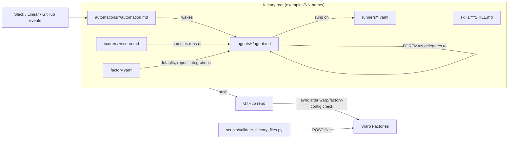
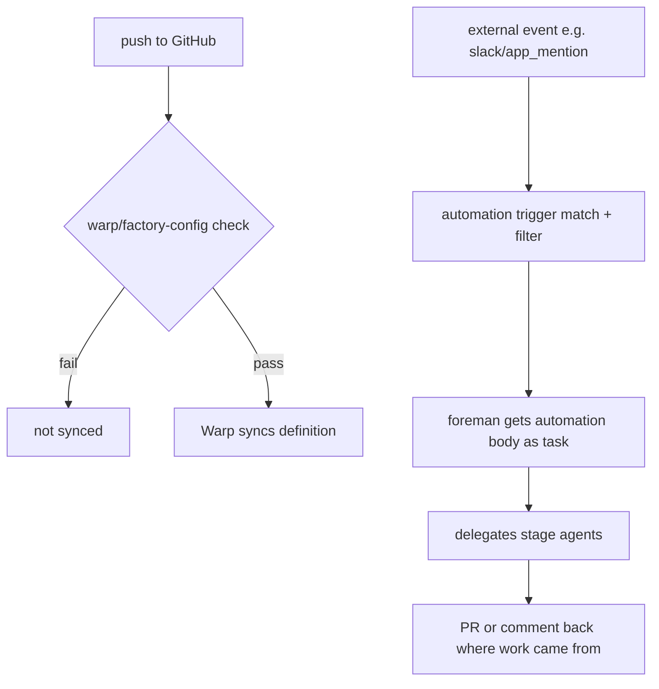
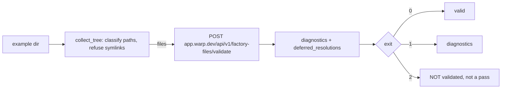

# warp-factory-examples — Architecture

> Clone: `raw/repos/.github-warpdotdev-warp-factory-examples/` · [warpdotdev/warp-factory-examples](https://github.com/warpdotdev/warp-factory-examples) @ `84e7c95`

> Scope: the file-based factory definition format as shown by the 8 examples, and the validation tooling. Not read in depth: agent prompt bodies other than the foreman and implementer, `CONTRIBUTING.md` prose, `test_*.py` bodies, `verify_default_agents.py` internals (header only).

## 1. Bird's-eye view

This is not an application. It is a corpus of **factory definitions**: directory trees that Warp Factories syncs from a GitHub repo and turns into a running "software factory" (a team of agents plus triggers plus compute). Everything is declarative. Behaviour lives in two places: YAML (topology, models, compute) and Markdown prompts (agent roles, automation instructions). The only code is Python helper scripts that ask Warp's server whether a tree is valid.

A resource's identity is its path. A factory has exactly one `FOREMAN` agent that orchestrates the others, automations that wake the foreman on external events, runners that pick the sandbox, and optional scorers (LLM judges) and skills. The model is **file-based, git-synced config**: push, wait for the `warp/factory-config` check, and the definition syncs ([README](https://github.com/warpdotdev/warp-factory-examples/blob/84e7c952f1506c4bd2784d96fd40a6f4d6398cad/README.md)).



## 2. Layout

- `examples/00-warp-default-agents/` — the five stock agents (foreman, triage, spec, implement, review) as files, verbatim.
- `examples/01-single-repo-quickstart/` — smallest working tree: 2 agents, 1 issue-label trigger.
- `examples/02-sdlc-issue-to-pr/` — full lifecycle: 6 agents, 5 automations, 3 runners, 2 scorers, shared and scoped skills.
- `examples/03-multi-harness/` — Warp Agent foreman, Claude Code implementer, Codex reviewer.
- `examples/04-code-review-only/` — one agent that is also the foreman; PR-opened trigger.
- `examples/05-ui-verification/` — computer-use verifier on a `linux-app` runner.
- `examples/06-common-automations/` — catalog: CI failure triage, weekly dependency audit, docs drift on push, Slack reaction intake.
- `examples/07-self-hosted-worker/` — `workerHost` routes runs to customer compute.
- `scripts/` — `validate_factory_files.py` (server validation), `check_conventions.py` (repo-local lint), `verify_default_agents.py` (drift of example 00 vs private warp-server seeds), and tests for the last two.
- `.github/workflows/validate.yml` — CI: schema-version drift, validate every example, conventions, unit tests.

Placeholders: nearly all repos are `acme/*`; each example README has a "Make it yours" checklist.

## 3. Entry flow: from file to running work



`factory.yaml` is the root manifest. From example 02:

```yaml
schemaVersion: v1alpha1
name: sdlc-issue-to-pr
alias: Acme
credentialStrategy: EXECUTOR
repositories:
  - owner: acme
    name: api-service
integrations:
  - type: slack
  - type: linear
agentDefaults:
  model: auto
  runner: linux-standard
```
[examples/02-sdlc-issue-to-pr/factory.yaml](https://github.com/warpdotdev/warp-factory-examples/blob/84e7c952f1506c4bd2784d96fd40a6f4d6398cad/examples/02-sdlc-issue-to-pr/factory.yaml) (excerpt; the real file also lists `webapp` and `ios-app`)

Rules stated in the README: name = path (rename = move file); exactly one agent with `agentType: FOREMAN` (alias `MAIN`); `model` and `harness` are mutually exclusive and `agentDefaults` declares exactly one; `secrets` / `mcpServers` on an agent or automation **replace** inherited lists, never merge; `skills/` is factory-wide, `agents/<name>/skills/` is agent-scoped.

## 4. Agents, foreman, and delegation

```mermaid
sequenceDiagram
  participant H as Human
  participant F as Foreman
  participant T as Triage
  participant S as Spec
  participant I as Implement
  participant M as mobile-build (CUSTOM, macOS)
  participant R as Review
  H->>F: Slack mention / Linear session / GitHub assign
  F->>F: addressing check (stop silently if not for us)
  F->>T: when scope unknown or maybe duplicate
  F->>S: when ambiguous or large
  S-->>H: spec PR, wait for approval
  F->>I: work item (+ spec PR)
  opt touches ios-app
    F->>M: own PR in ios-app
  end
  F->>R: review each PR
  R-->>F: findings, relayed to PR owner until clean
  F->>F: apply factory:alias label
  F-->>H: final PR links; human merges
```

Agent files are Markdown with YAML frontmatter (`description`, `agentType`, optional `runner`, `model` or `harness`) and a prompt body. The foreman prompt is a numbered procedure; it **orchestrates but does not do the work**, and encodes the human gate:

```markdown
A human is always responsible for merging. Never merge, and never approve a
spec on a human's behalf.
```
[examples/02-sdlc-issue-to-pr/agents/foreman/agent.md:41-42](https://github.com/warpdotdev/warp-factory-examples/blob/84e7c952f1506c4bd2784d96fd40a6f4d6398cad/examples/02-sdlc-issue-to-pr/agents/foreman/agent.md#L41-L42)

Design points visible in the files:
- Per-stage models: triage `auto-efficient`, reviewer `auto-genius`; review deliberately runs on a different model than implementation so they do not share blind spots.
- One branch and PR live in one repository, so multi-repo changes need one PR per repo ([foreman L22-28](https://github.com/warpdotdev/warp-factory-examples/blob/84e7c952f1506c4bd2784d96fd40a6f4d6398cad/examples/02-sdlc-issue-to-pr/agents/foreman/agent.md#L22-L28)). The foreman waits for all PRs before hand-off.
- Routing label `factory:<alias>` is applied by the foreman to every PR (step 6).
- Example 04 collapses roles: the reviewer is also the foreman, findings are advisory.

## 5. Harnesses, runners, and secrets

Two orthogonal axes per agent: **who thinks** (harness or model) and **where it runs** (runner).

```yaml
harness:
  type: claude
  model: opus
  auth:
    source: managedSecret
    secretName: ANTHROPIC_API_KEY
```
[examples/03-multi-harness/agents/implementer/agent.md:5-10](https://github.com/warpdotdev/warp-factory-examples/blob/84e7c952f1506c4bd2784d96fd40a6f4d6398cad/examples/03-multi-harness/agents/implementer/agent.md#L5-L10)

- `model: auto|auto-efficient|auto-genius|<id>` is shorthand for the Warp Agent harness. `harness.type` can name Claude Code or Codex (example 03 uses Codex for review), authenticated with a managed secret.
- Runners are `runners/<name>.yaml`: `instanceShape` (vcpus, memoryGb; Linux powers of two) and `platform` (os, arch, `linux.dockerImage` or `mac.version`). macOS runners are VMs, so no `dockerImage`; macOS is aarch64 only.

```yaml
instanceShape:
  vcpus: 6
  memoryGb: 14
platform:
  os: macos
  arch: aarch64
```
[examples/02-sdlc-issue-to-pr/runners/macos-build.yaml:5-11](https://github.com/warpdotdev/warp-factory-examples/blob/84e7c952f1506c4bd2784d96fd40a6f4d6398cad/examples/02-sdlc-issue-to-pr/runners/macos-build.yaml#L5-L11)

- Self-hosting: `agentDefaults.workerHost: factory-worker` plus a runner whose platform matches the worker (Linux amd64/arm64 only). Warp coordinates; runs execute on customer compute ([example 07 factory.yaml](https://github.com/warpdotdev/warp-factory-examples/blob/84e7c952f1506c4bd2784d96fd40a6f4d6398cad/examples/07-self-hosted-worker/factory.yaml)).
- `credentialStrategy: EXECUTOR` in example 02 sets whose credentials runs use.

## 6. Automations, scorers, skills

Automations are the triggers. Frontmatter lists `triggers` (provider, event, optional `filter`); the body is the task prompt handed to the foreman.

```markdown
triggers:
  - provider: github
    event: issue_labeled
    filter:
      repos: [acme/api-service]
      labels: [factory-ready]
```
[examples/01-single-repo-quickstart/automations/issue-labeled/automation.md:2-8](https://github.com/warpdotdev/warp-factory-examples/blob/84e7c952f1506c4bd2784d96fd40a6f4d6398cad/examples/01-single-repo-quickstart/automations/issue-labeled/automation.md#L2-L8)

Providers seen: `slack` (`app_mention`, `message_dm`), `linear` (`agent_session_created`), `github` (issue/PR mention and assign, `issue_labeled`, PR opened, closed/merged, `workflow_run_completed`). Filter keys combine with AND. Example 02's PR-closed automation completes work items; example 06 is the standing-automation catalog (weekly dependency audit; CI triage that opens a fix PR or an issue).

**Scorers** are LLM judges attached to agents. They form the eval loop:

```yaml
agents:
  - implementer
labels:                      # compliant=1, partial=0.5, non_compliant=0
passingScore: 1
samplingRate: 25
model: claude-4-5-haiku
selfImprovement: true
```
[examples/02-sdlc-issue-to-pr/scorers/task-compliance/scorer.md:2-30](https://github.com/warpdotdev/warp-factory-examples/blob/84e7c952f1506c4bd2784d96fd40a6f4d6398cad/examples/02-sdlc-issue-to-pr/scorers/task-compliance/scorer.md#L2-L30) (condensed; the labels are listed with descriptions in the file)

`samplingRate` is the percent of runs scored; `selfImprovement: true` feeds results back to improve the agent. Judging is from the issue text, not the PR's self-description.

**Skills** (`SKILL.md`) are shared knowledge: `skills/repository-conventions` for every agent, `agents/implementer/skills/testing-standards` for one.

## 7. Validation tooling



- `validate_factory_files.py` deliberately does **not** parse YAML itself: the server owns the verdict. Its `classify()` only chooses which files to upload and mirrors server path rules ([L106-L143](https://github.com/warpdotdev/warp-factory-examples/blob/84e7c952f1506c4bd2784d96fd40a6f4d6398cad/scripts/validate_factory_files.py#L106-L143)). Limits: 256 files, 256 KiB per file, 2 MiB total, 10 s timeout. No credential required; `WARP_API_KEY` is forwarded if present. Exit 2 means "could not check", kept distinct from failure.
- `check_conventions.py` checks repo-local invariants: every `runner:` resolves, scorer `agents:` exist, one foreman per example, `examples/<name>` links exist, and product terminology (the five agents are "the default agents"; "Warp Factories" written in full).
- `verify_default_agents.py` diffs example 00 against warp-server's private seed files (`logic/factorysource/defaults/`), on demand for Warp maintainers; exit 2 = source unavailable.
- CI ([validate.yml](https://github.com/warpdotdev/warp-factory-examples/blob/84e7c952f1506c4bd2784d96fd40a6f4d6398cad/.github/workflows/validate.yml)) runs on PR, push to main and a weekly cron. It first fails if the server's `current_version` moves off pinned `v1alpha1`, then validates every example (one retry on exit 2), then runs conventions and unit tests.

## Reading order

1. `README.md` — the layout rules in one place.
2. `examples/01-single-repo-quickstart/` — minimal tree.
3. `examples/02-sdlc-issue-to-pr/README.md` and `agents/foreman/agent.md` — full lifecycle and delegation.
4. `examples/03-multi-harness/agents/` — harness and auth syntax.
5. `scripts/validate_factory_files.py` — how a tree is submitted and judged.

## Connections

- **Entities**: [[wiki/entities/claude-code]], [[wiki/entities/codex]], [[wiki/entities/github]], [[wiki/entities/slack]], [[wiki/entities/linear]], [[wiki/entities/warp-factories]]
- **Concepts**: [[wiki/concepts/software-factory]], [[wiki/concepts/factory-as-code]], [[wiki/concepts/foreman-agent]], [[wiki/concepts/agent-harness]], [[wiki/concepts/agent-skill]], [[wiki/concepts/agent-evals]], [[wiki/concepts/human-in-the-loop]], [[wiki/concepts/self-hosting]], [[wiki/concepts/secrets-management]], [[wiki/concepts/multi-repo-development]], [[wiki/concepts/control-plane]]

> Synthesis: a software factory here is a git repo of path-named Markdown and YAML, with one foreman prompt as the only orchestration logic and a human merge as the hard stop; the server, not the repo, owns the schema.
