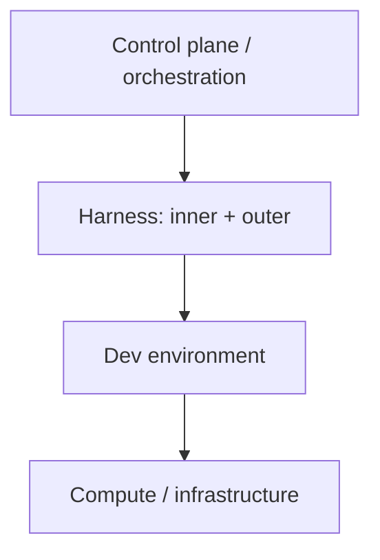

# How to Build a Software Factory for AI Coding Agents

> [[raw/youtube-tGbjIvvYuHE|Raw]] · youtube · Boundary · 1:10:45 · auto-captions (names may be misheard)

## Summary

Episode of "AI That Works" with Dex (CEO, Human Layer) and Vaibhav (co-founder, Boundary, maker of BAML). After a tangent on Codex versus Claude models, the core is a zoom-in on the "agent builds the thing" part of a software factory: the layers you assemble, and which to build or buy. [[raw/youtube-tGbjIvvYuHE#22:10|cite]]

Dex lays out the stack as compute/infrastructure, dev environment, harness (inner and outer) and control plane/orchestration. Each can be built in-house, bought from a vendor, or mixed. His thesis is composition over inheritance: buying at one layer should not force buying everything below it. [[raw/youtube-tGbjIvvYuHE#55:57|cite]] Vaibhav contrasts this with Boundary's own factory, "agent tries BAML" (ATB): a pool of MacBooks as compute, Claude Code or Codex in headless mode as harness, hard-coded while loops as outer harness, and a hosted web app that listens to Slack, Linear and GitHub as dispatcher. [[raw/youtube-tGbjIvvYuHE#23:10|cite]]

The talk closes on interfaces (ACP, AG-UI, MCP), why no open-source control plane exists yet, and "extendable software" where agents write code that extends the app. [[raw/youtube-tGbjIvvYuHE#51:24|cite]]

## Key claims

- Boundary's loop: a hard-coded while loop fixes CodeRabbit comments until mergeable, or stops after 3 iterations and asks a human; a human still presses merge. A planned follow-on agent keeps the PR merged-up against main ("an agentic merge queue"). [[raw/youtube-tGbjIvvYuHE#24:10|cite]] [[raw/youtube-tGbjIvvYuHE#25:40|cite]]
- User feedback is untrusted: check if already fixed, dedupe, produce an agent-built repro, only then create an issue and assign a human "shepherd" via Slack. Every pipeline change must ship eval metrics; dedupe accuracy is known to be lower than hoped, 60% is the target for difficulty classification. [[raw/youtube-tGbjIvvYuHE#15:32|cite]] [[raw/youtube-tGbjIvvYuHE#19:35|cite]]
- Aim for 95% automatic, not fully automatic. [[raw/youtube-tGbjIvvYuHE#31:44|cite]]
- Dex argues the dev environment is its own layer (runtimes, preview, identity, shared internal services), and that vendor sandboxes add friction once you need access to many internal services. He frames pets versus cattle for environments; Boundary's MacBooks are pets. [[raw/youtube-tGbjIvvYuHE#33:47|cite]] [[raw/youtube-tGbjIvvYuHE#42:19|cite]]
- Control plane duties: dispatch, session traces, plans, scheduling, review, permissions/audit, spend, and compounding engineering (team-wide corrections fed back into the outer harness). [[raw/youtube-tGbjIvvYuHE#39:55|cite]]
- Multi-repo: simulate a monorepo by running sessions from one coordination directory that tells the model where the other repos are; avoid git submodules, subtrees are possibly better. [[raw/youtube-tGbjIvvYuHE#45:30|cite]]
- No open-source control plane exists because every company defines issues and workflows differently and code is cheap to write; ACP is too narrow and neither ACP nor AG-UI supports hooks. [[raw/youtube-tGbjIvvYuHE#1:00:13|cite]] [[raw/youtube-tGbjIvvYuHE#51:24|cite]]
- Large features: Dex queues about 15 prompts overnight of implement/review/Codex-review, treats the result as a "slop PR" spec, then has the model split it into 1-3k line PRs. [[raw/youtube-tGbjIvvYuHE#11:08|cite]]

## Notable quotes

> "You should have as an engineer choice and the ability to like work in open systems and plug these things together."
> — [[raw/youtube-tGbjIvvYuHE#56:59|56:59]]

> "I think the folly that a lot of people make is they try and make a system that is fully automatic. That is much harder than getting a system that's 95% automatic."
> — [[raw/youtube-tGbjIvvYuHE#31:44|31:44]]

## Connections

- **Entities**: [[wiki/entities/claude-code]], [[wiki/entities/codex]], [[wiki/entities/coderabbit]], [[wiki/entities/human-layer]], [[wiki/entities/baml]]
- **Concepts**: [[wiki/concepts/software-factory]], [[wiki/concepts/agent-harness]], [[wiki/concepts/control-plane]], [[wiki/concepts/dev-environment]], [[wiki/concepts/compounding-engineering]], [[wiki/concepts/agentic-merge-queue]], [[wiki/concepts/multi-repo-development]], [[wiki/concepts/agent-evals]], [[wiki/concepts/human-in-the-loop]]

> Synthesis: Speakers are vendors (Human Layer sells the control plane, Boundary builds its own), so the layer model and "own your dev environment" lean toward their products; treat it as a practitioner design vocabulary, not neutral analysis.
